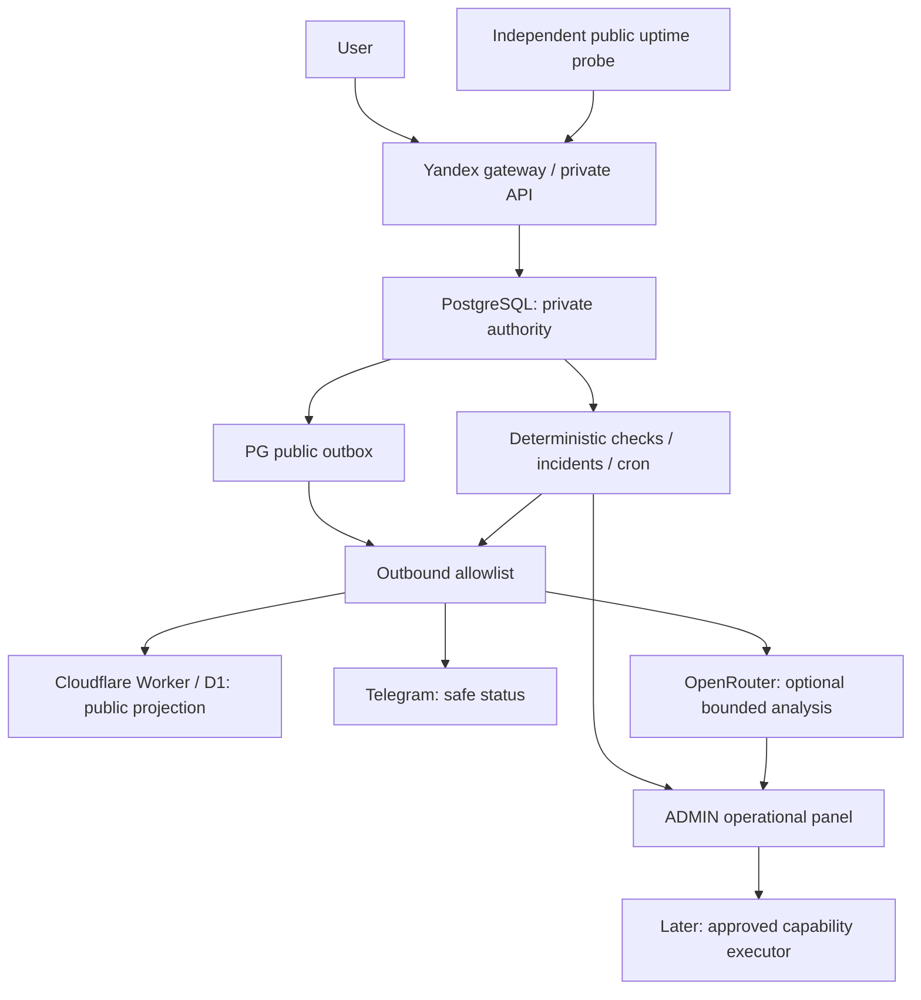

# GameScout: Reality Check AI Operator и минимальная архитектура

Дата: 30.09.2026. Исходный commit: `e9aa517`, ветка `codex/core-handoff-main`, рабочее дерево до аудита чистое. Это предложение, а не разрешение создавать ресурсы или включать AI actions. Production, DNS, регистрация, платежи и данные в этой сессии не менялись. Актуальные эксплуатационные блокеры — в [core-progress.md](core-progress.md). Существующий roadmap и его SHOULD HAVE/LATER сохраняются.

**Рекомендация:** оставить текущую Yandex VM/PostgreSQL, public Worker/D1 и PostgreSQL outbox. Добавить небольшие модули в private API: безопасный operational snapshot, incidents, egress policy, retention, ручные data requests. Сначала детерминированные проверки и уведомления; Sonnet — по событию или кнопке ADMIN. Новая VM, managed DB, Redis, Kafka, vector DB, отдельный MCP server и платный monitoring сейчас не нужны.

## Что реально проверено

VERIFIED означает конкретное наблюдение; для кода не означает production end-to-end. LIKELY — обоснованный вывод; HYPOTHESIS — предложенное решение/оценка; BLOCKED — указанная непроверенная зависимость.

| Часть | Статус и факт | Ограничение / следующий шаг |
|---|---|---|
| VM/PostgreSQL/private API | VERIFIED по журналу последнего релиза: существующая VM, 21 миграция, health, ADMIN, ledger/refund; отдельная PostgreSQL rehearsal прошла 3 игры | Живые новые пользовательские сценарии не приняты; регистрация закрыта. В этом аудите повторный live SSH не выполнялся |
| Public boundary | VERIFIED по коду: `public-snapshot.mjs` публикует facts, restrictions, агрегаты, claimed boolean; не owner/user ID. `app.mjs` public relay отправляет только Accept | Query string переносится целиком; нужен allowlist имен/значений. Free text, ссылки, monitoring apiUrl тоже требуют правил: URL может содержать credentials/token/ПДн |
| Worker PUBLIC_ONLY | VERIFIED по предыдущему live журналу | Не доказывает отсутствие ПДн в сетевом трафике/логах. Остались 32 historical server_events с visitor hash |
| Public projection | VERIFIED по коду: PG transaction + outbox, version/идемпотентность, lease/retry/lag alerts | BLOCKED по последней live проверке: 70 initial snapshots pending, настройки VM delivery не завершены; перенос секрета ранее отклонен auto-review. Не считать D1 синхронизированной |
| Backup/cron | VERIFIED по последнему журналу: зашифрованная копия, восстановление вне VM, исправленный cron | Первый автоматический backup и копия recovery kit вне ПК еще не подтверждены. Свежесть копии не доказывает возможность восстановления |
| Admin operations | VERIFIED по коду: queues/system alerts/audit summary существуют в `app.mjs` | Полноценного AI Operator, capability executor, GitHub connector и incident approval flow пока нет |
| Copyright AI | VERIFIED по коду: scope restriction, private audit, PG outbox, human restore | `analyzeCopyright` отправляет rights_basis, work_description, material_url, evidence как свободный текст; ПДн могут оказаться внутри. Публичное ограничение не доставится, пока projection заблокирована |
| Nickname AI | VERIFIED по коду: локальный фильтр/queue, ALLOW/ANONYMOUS/REVIEW; connector отправляет ник | Ник может содержать контакт или настоящее имя. Local filter не является доказательством обезличивания |
| Telegram | VERIFIED по коду: copyright message содержит event/IDs/scope/classification; очередь и retry есть | BLOCKED: последняя инвентаризация VM не обнаружила Telegram credentials; live delivery/approval не проверены |
| OpenRouter | VERIFIED по коду: connectors, hourly balance check и low-balance alert | $10 — сообщение владельца, не текущий API замер. Последняя VM инвентаризация не обнаружила ключей. Общих cost caps нет; AI retry не имеет конечного лимита попыток |
| Egress firewall | VERIFIED: общей библиотеки strict outbound schemas не обнаружено в проверенных коннекторах | Нельзя включать AI с raw evidence прежде минимизации |
| Retention | VERIFIED: logout/reset/consume удаляют отдельные sessions/tokens/OAuth states; периодический purge не найден в private-api | Истечение доступа не равно удалению строки. Ledger/refunds/audit защищены immutable triggers; blanket DELETE недопустим |
| Data request/export | HYPOTHESIS: предлагаемый минимальный workflow | Общий утвержденный flow/export/deletion и юридическая проверка не подтверждены |
| Legal / external transfers | BLOCKED: не подтверждены реквизиты оператора, уведомления и перечень передач. Gmail SMTP остается внешним каналом | Наличие policy на сайте не закрывает это. Прямые страницы pd.rkn.gov.ru не прочитались; используются официальные разъяснения прокуратуры, ниже |
| Webmaster AI | LATER | Сначала закрыть существующий production HTML SEO, затем доступы к кабинетам |

Проверенные файлы: `private-api/app.mjs`, `production-config.mjs`, `maintenance.mjs`, `copyright.mjs`, `nickname-review.mjs`, `openrouter-balance.mjs`, `public-snapshot.mjs`, миграции 001/004/021, `ru-proxy/handler.mjs`, frontend Turnstile widget; верхняя сводка core-progress, roadmap и git status. Это статический аудит + предыдущие датированные live свидетельства, а не новое полное обследование облака.

## Ответы на 19 вопросов

1. **Избыточно сейчас:** автономный coding agent с production actions, Opus escalation по умолчанию, MCP сразу для двух облаков, отдельный runtime/service и комплексная compliance platform. Ядро еще имеет важные live блокеры; AI SRE не должен отодвинуть их.
2. **Убрать из MVP:** arbitrary shell/SQL/cloud tools, постоянный LLM polling, raw logs в AI/GitHub, платную APM, embeddings/RAG всей базы, автоматический merge/deploy и юридические решения модели.
3. **Упростить:** read-only snapshots из существующих admin queries, PG очередь событий, один короткий cron worker, один outbound library и ручная кнопка «разобрать инцидент». Установку platform agents не делать ради нескольких метрик.
4. **Бесплатные альтернативы:** локальные SQL/health checks + cron; нативные resource metrics Yandex; Telegram Bot API; прямой GitHub API; Better Stack free только для внешнего uptime. Uptime Kuma — бесплатное self-host ПО, но ему нужны ресурсы и независимое место запуска для обнаружения падения основной VM. [Uptime Kuma](https://github.com/louislam/uptime-kuma).
5. **Платный сервис вместо своей функции:** alert dedup, heartbeat, projection lag и queue counters уже можно делать самим. Yandex Monitoring не полностью бесплатен: автоматические resource metrics и чтение в console бесплатны, custom metric writes и Monitoring API reads тарифицируются. Не называть весь стек free tier. [Yandex pricing](https://yandex.cloud/en/docs/monitoring/pricing).
6. **Объединить:** nickname/copyright/operator через один egress и cost accounting; incidents и alerts на существующем PostgreSQL; maintenance через существующий cron. При этом права и бюджеты разных назначений разделить, а raw private context не передавать общему внешнему агенту.
7. **Boundary в целом верный**, но «public» не обязательно означает «не ПДн»: ник, личный Telegram link, IP игрового сервера физлица, произвольный текст могут идентифицировать человека. Публичная видимость сама по себе не снимает требования закона. Claimed boolean и суммы безопаснее owner_id/участников ledger. Public restrictions должны содержать material key, а не claimant/evidence/reason с ПДн. В публичном мониторинге URL не должен содержать private API ключ. PG остается authority, D1 — eventual projection; успешная транзакция не требует одновременного commit в D1.
8. **Даже без собственной записи наружу могут попасть:** IP/UA/referrer/query/browser fingerprint через Turnstile; IP/headers при прямом Worker visit; provider metadata OAuth, SMTP recipient и текст письма; avatar/media hosts при загрузке браузером; referrer во внешние ссылки; облачные proxy/access logs; GitHub Actions artifacts; содержимое model tool results и query strings. VERIFIED: public relay пересоздает headers, но копирует query; Turnstile widget грузит script с Cloudflare. LIKELY: поставщики обрабатывают сетевые метаданные; точное логирование/retention конкретных аккаунтов не проверено. Отключить лишнюю аналитику/replay, не передавать visitor IP в Worker из private API; проверить CSP/referrer policy и внешние assets. Turnstile server verification сейчас может передавать remoteip — это отдельный канал, не D1 storage.
9. **MCP не нужен.** Это интерфейс tools, не дополнительная безопасность и не обязательная платная услуга. Для GitHub хватает REST + repo-scoped fine-grained PAT на read-only прототипе; для постоянного writer лучше GitHub App на один repo, short-lived installation token. Доступ contents/PR/actions только необходимый; no admin/secrets/workflows write. Tests запускаются отдельным CI без production secrets/data. Обычный запуск Actions не гарантирует безопасность: workflow может выполнять код PR и иметь deploy permissions. [GitHub App permissions и tokens](https://docs.github.com/en/apps/oauth-apps/building-oauth-apps/differences-between-github-apps-and-oauth-apps), [Actions billing](https://docs.github.com/en/billing/concepts/product-billing/github-actions).
10. **Самый дешевый AI:** правила обнаруживают проблему; модель получает один ограниченный snapshot для нового инцидента. Повтор того же состояния не вызывает inference. Без ключа/при low balance — детерминированный alert и human review. Бесплатную случайную модель не использовать как основание для production/legal action; локальная LLM на 2 GB VM — плохой обмен ресурса ядра на слабую модель.
11. **Автоматически:** read-only health/metrics, безопасная классификация технической ошибки, private incident report; после внедрения конкретных guards — retry idempotent public job, ограниченный restart только API. GitHub issue/PR автоматически допустимы только после отдельной egress проверки diff/body и доверенной настройки repository permissions; до этого черновик хранить в RU admin. У copyright — только детерминированная полнота/target checks и строго scoped обратимое удержание после проверенных условий, без окончательного вердикта.
12. **С подтверждением владельца:** migration, DNS, IAM, secrets, удаление/экспорт третьим лицам, финансовые действия, production deploy, новый scope ограничения, смена публичной политики и инфраструктуры. Rollback НЕ автоматически безопасен: предыдущая версия должна быть совместима со схемой/данными. После первого Support refund нельзя возвращать приложение, которое считает отмененную Поддержку активной. Не давать API Docker socket: это фактически host root.
13. **PII firewall:** одна библиотека внутри private API подходит для MVP, но это policy enforcement, не математическая гарантия отсутствия ПДн. Strict schemas/allowlists каналов, фиксированные destinations, лимиты текста, контроль URL/query, reject неизвестных полей, regex/secret scan как второй слой. Нужен запрет обхода через прямой fetch в проектных правилах/проверке кода. Модель не должна иметь raw DB/log access. Service auth headers добавляет connector ПОСЛЕ проверки business payload; blanket ban Authorization сломает нормальные API. Transactional email/payment/OAuth имеют отдельные разрешенные цели и recipient fields: их нельзя объявлять обезличенными или блокировать как обычный AI outbound. Safe public release имеет отдельную declassification policy.
14. **Data requests:** сначала ручной ADMIN workflow, одна таблица request/status/scope/legal basis/deadline/decision + audit. Проверить requester/полномочия, создать manifest выбранных записей, сгенерировать JSON/export в RU, краткоживущая authenticated download ссылка, повторная авторизация и audit скачивания. Экспорт не включает secrets/hashes/чужие данные; юзер получает только допустимые свои записи. AI может предложить scope, но не разрешает раскрытие. Удаление сначала закрывает доступ/отзывает sessions/OAuth; удаляет разрешенную identity/security информацию; ledger/legal hold не каскадно сносится. Нужен тест с FK/immutable audit; ни token, ни email не помещать в export URL.
15. **Retention:** стартовые предложения в таблице ниже; это политика MVP, не утвержденные законные сроки. Хранить данные только для конкретной цели; сроки зависят от voting window, disputes и бухгалтерской модели. Сначала dry-run counts, затем маленькие batches, метрика удалений и запрет legal hold; destructive legacy purge отдельно согласуется.
16. **До открытия регистрации:** определить оператора/цели/правовое основание/состав данных/доступы; проверить уведомление РКН и внешние передачи; policy совпадает с фактической обработкой; отдельное согласие там, где выбрано основание consent; рабочий канал requests и incident procedure; retention; recovery kit и автоматический backup; mail provider/credentials; основной live account/claim/vote/support flow и API permissions. Продажи по-прежнему закрыты до платежной/чековой готовности. AI Operator не является условием открытия регистрации.
17. **Отложить:** PR-writing autonomy, Opus auto escalation, сложные rollbacks, SEO agent/Webmaster API, media evidence AI, Rust/CS2/DayZ, платные dashboards/APM, самостоятельное исполнение запросов госорганов.
18. **За 1–2 инженерных дня (HYPOTHESIS):** strict outbound DTO/каналы и tests на synthetic ПДн; operational read-only snapshot из существующих queries; backup/cron heartbeat; local incident dedup + Telegram template; dry-run retention expired auth tokens; ручная request инструкция. Это большая часть operational visibility, а не готовый автономный SRE. GitHub coding sandbox, legal approval и доступы не гарантированно укладываются в эти дни.
19. **Более простая архитектура есть:** один private monolith на текущей VM + PG queues; внешняя проверка доступности только safe endpoint; optional Sonnet внутри этого монолита; фиксированный host runbook executor позже. Новые managed сервисы сейчас не нужны.

## Минимальная целевая схема

Операторный runtime может быть one-shot Node процессом на той же VM с отдельной ограниченной DB ролью и capabilities. Он не должен наследовать production API secrets/environment целиком. Для read tools выдавать только готовые snapshots, не SQL. Монитор не видит raw request bodies. Host executor позже — отдельный пользователь/фиксированный helper с allowlist аргументов и узким sudo rule на restart одного сервиса; не универсальный CLI/root. Yandex API нужен только для конкретных cloud status/metrics read scopes; local health не требует cloud API. Cloud Function/API gateway/MCP ради такого wrapper сейчас не нужны. Фактическую таблицу IAM permissions получить при внедрении нужного API, не выдавать generic viewer/admin на всё облако.

Каждый action: incident ID + dedup key, capability name/version, target, expected current state, idempotency key, authorized_by/policy version, budget reservation, start/finish/result, before/after, rollback reference. Check policy выполняет сервер, не текст модели. Не хранить полный secret-bearing prompt/tools result в audit. Одновременные jobs — lease/lock, deadline, finite attempts и cooldown. По 3 неудачам — stop/escalation; перезапуск без конца запрещен. Model suggestions, code/issues/complaints — untrusted input: prompt injection не может расширить права или определить новый command.

## Monitoring: три простых варианта

| Вариант | Что закрывает | Цена сверх текущей инфраструктуры | Ограничения |
|---|---|---|---|
| A: Yandex resource metrics + cron + Telegram | VM базовые метрики; PG SELECT 1/pool/locks; queue/dead jobs; projection oldest pending/lag; backup upload/restore age; maintenance heartbeat | Resource metrics/console — 0; собственные checks используют текущую VM. Custom writes/API reads оплачиваются по usage, их пока не добавлять автоматически | Один cron на VM не обнаружит смерть этой VM. Нативные VM metrics не заменяют application uptime. Notification channel и alerts в аккаунте еще не проверены |
| B: Better Stack free + A для внутренних деталей | Независимый HTTP uptime, SSL, heartbeat; никаких private logs | 0 в free limits | Официальная uptime страница: 10 monitors, 10 heartbeats, 3-minute checks; pricing страница формулирует 10 monitors & heartbeats. Точные combined quota/Telegram webhook на выбранном free аккаунте уточнить при setup; не считать Telegram интеграцию доказанной. Только технический endpoint без PII/auth, no session replay/screenshots аккаунта |
| C: небольшой scheduled Cloudflare Worker + A | Независимый probe API/backup heartbeat и safe Telegram alert | 0 при существующем Workers Free лимите; например 1 вызов/5 min = 288/day | Использует уже существующего внешнего провайдера, но требует немного собственного кода/dedup и fallback при падении CF. Хранит только service/status/counter/time; не admin chat updates/raw errors. Новых приватных таблиц в D1 не создавать |

Для строгого «без нового SaaS» рекомендую C + бесплатные части A. Если цель быстрее получить внешний uptime без своего кода, B приемлем при проверке free условий. Одна VM с Uptime Kuma не дает независимости; поднимать вторую ради monitor сейчас не нужно. GitHub cron — запасной informational check, не on-call гарантия: GitHub допускает задержку и пропуск scheduled runs. [Better Stack uptime](https://betterstack.com/uptime), [pricing](https://betterstack.com/pricing?device=c), [Workers pricing](https://developers.cloudflare.com/workers/platform/pricing/), [GitHub schedule](https://docs.github.com/en/actions/reference/workflows-and-actions/events-that-trigger-workflows#schedule).

Public probe показывает только `ok/degraded` и opaque service ID. Detailed queues, backup object names, internal hostnames, error stack и финансовая reconciliation остаются ADMIN/RU. Ручной recovery нужен независимо от доступности самого AI.

## OpenRouter: расходы и routing

VERIFIED по официальным страницам 30.09: `anthropic/claude-sonnet-4.6` — $3/M input, $15/M output; `anthropic/claude-opus-4.6` — $5/M input, $25/M output. Проверять цены выбранного endpoint перед включением; routing к более дорогим endpoints ограничить, tools/web search отключить. [Sonnet](https://openrouter.ai/anthropic/claude-sonnet-4.6), [Opus](https://openrouter.ai/anthropic/claude-opus-4.6).

Расчет простого анализа, а не coding agent: 2 000 input + 500 output tokens = $0.0135 Sonnet или $0.0225 Opus. 100 таких Sonnet анализов = $1.35. Это собственная арифметика, без retries, дополнительных reasoning/tool tokens и top-up fees. Баланс ~$10 может оплатить примерно 740 таких одиночных запросов; не обещать число полноценных расследований — они могут иметь много turns и больше context.

Предлагаемые настройки (HYPOTHESIS): сначала operator budget $2/month, $0.10/day, $0.05/incident; max 1 analysis + 1 controlled retry, общий timeout; reserve worst-case cost в PG перед запросом. Отдельно учитывать nickname/copyright расходы. Cap относится к сумме всех вызовов инцидента, а не только финального ответа. После network timeout не считать неудачный ответ бесплатным. Low balance < $2: некритичные AI выключены, ручная очередь/alerts сохраняются. Opus только по отдельной кнопке с видимой оценкой; автоматический model fallback пока убрать, provider fallback разрешать лишь с теми же privacy/price constraints. Ноль доступных подходящих providers => ручная обработка, не ослабление политики.

В ключе OpenRouter установить spending limit как второй барьер; локально держать daily + monthly + per incident limits одновременно. Key API дает remaining/usage без inference; management key шире по полномочиям, не отдавать модели и по возможности не держать в API для одного read budget. Для точного account balance существующий `/credits` connector проверить отдельно. [Key usage](https://openrouter.ai/docs/api/api-reference/api-keys/get-current-key), [management limits/reset](https://openrouter.ai/docs/guides/overview/auth/management-api-keys).

Поставить `provider.zdr=true`, `data_collection=deny`; отключить opt-in prompt logging/data use и сторонние plugins. ZDR ограничивает inference providers, не отменяет саму передачу и request metadata OpenRouter; политика не распространяется автоматически на web tools/plugins. Текущие connectors этих параметров не устанавливают. [Routing](https://openrouter.ai/docs/guides/routing/provider-selection), [ZDR](https://openrouter.ai/docs/guides/features/zdr), [data collection](https://openrouter.ai/docs/guides/privacy/data-collection).

## Egress и copyright: как внедрить без отдельного сервиса

Предлагаемый `private-api/egress.mjs`: разные export schemas `publicProjection`, `aiIncident`, `aiCopyright`, `telegramIncident`, `githubReport`, `transactionalMail`; connectors принимают только результат этих builders. Unknown keys отвергаются. DTO складывается из явно разрешенных полей, а не sanitizer над `JSON.stringify(SELECT *)`. Длина/URL origin/path/query allowlist, no credentials в URL, no arbitrary destinations/redirect, запрет raw IP/email/device/cookies/token/hash/requestbody. Semantic names/raw evidence распознать regex гарантированно невозможно: fail closed для неподготовленного free text, оставить human review. Incident refs по возможности одноразовые и не связаны с public user; стабильный opaque user_ref/hash остается псевдонимом, а не доказанным обезличиванием.

Copyright external DTO: material category, target-match result, evidence_present, rights_basis category, completeness flags, проверенные public facts. Claimant/evidence файлы и original text остаются RU. Без содержательного текста качество AI triage ограничено: модель не сможет надежно отличить FAKE/VALID по одним boolean. Поэтому ALLOW/VALID — не доказательство прав; можно оставить ручную классификацию и бесплатно получать всю нужную операционную пользу. Позже вводить ограниченный проверенный excerpt только после egress/legal review.

При полном запросе и точном public target хранить private review case. Автоматическое temporary restriction разрешать только детерминированным policy: конкретный material key, verified target, ограниченный scope, audit+outbox, notify/admin review deadline и ручной restore. Нельзя только по текстовому AI ответу блокировать всю карточку или добавлять новые targets. Истечение review lease — отдельное правило с эскалацией; не обещать безусловное авто-восстановление, если действуют несколько ограничений/ручной legal hold. FAKE от модели без достаточных оснований направлять человеку, а не необратимо закрывать дело.

Telegram сначала уведомления + ссылка на authenticated ADMIN incident без login/export token. Callback approval позже: allowlist owner user/chat IDs, webhook secret, short-lived one-use nonce bound к action/target/version, server-side policy и audit; чужой/устаревший callback не исполняется. Миграции/DNS/secrets/ПДн exports по Telegram одной кнопкой не разрешать. [Bot API webhook](https://core.telegram.org/bots/api#setwebhook). Стандартные небольшие bot сообщения бесплатны; платный high-volume broadcast здесь не требуется. [Bots FAQ](https://core.telegram.org/bots/faq).

## Retention: предложенные сроки MVP

| Данные | Предложение, НЕ законный универсальный срок |
|---|---|
| Sessions | Действуют по session TTL; expired/revoked purge в течение 24h; историю auth outcomes без session token отдельно |
| OAuth state / verification / reset | Сохранить текущий короткий TTL; consume одноразовый; expired purge ≤24h; незавершенные аккаунты 7 дней при отсутствии иных оснований |
| Delivered mail payload | Удалить encrypted payload через 24h после delivery; оставить минимальные delivery counts/status 30 дней, no mail body/recipient в public/AI |
| IP/device security signals | Default 7–30 дней по конкретной цели; vote uniqueness records — rolling window W + 7 дней для разбирательства; не ломать длинное W ранним purge. Hash/salt не означает отсутствие ПДн |
| Application logs | 7 дней, без request bodies/auth headers; security outcomes 30 дней; serious incident — legal hold |
| Completed jobs/public outbox | 7 дней после подтвержденного delivery; последнее version/receipt сохранить для идемпотентности; failed jobs 30 дней с dead-letter/admin решением, no infinite retry |
| AI analysis | Минимальный decision/evidence references в private audit; bounded sanitized context 7 дней при необходимости, не raw prompt/evidence копии |
| Copyright evidence | Пока дело активно/есть legal hold; предложить 90 дней после закрытия обычного дела, срок спора отдельно утверждает owner; не применять одинаково к всем правовым претензиям |
| Ownership grants/decisions | Пока права действуют + предложенный период спора после прекращения; не удалять доказательства активных прав. Срок после прекращения должен быть утвержден отдельно |
| Ordinary operational audit | Проектный ориентир 90 дней; security/admin accountability до 1 года по утвержденной цели. Сейчас immutable trigger: нужен безопасный archival/retention design, не обход запрета удаления |
| Payments/ledger/refunds | Срок по применимому учету/обязательствам и спорам; не общий purge. Для бухгалтерских документов закон предусматривает минимальные сроки, но это не дает автоматически одинакового срока всем Coins событиям; форма оператора/учет еще BLOCKED |
| Encrypted backups | Существующие 14 дней; удаления отражаются по истечении backup lifecycle, при restore повторить suppression/deletion manifest прежде открытия доступа; legal hold отдельный controlled процесс |
| Data request export | 24h downloadable, delete file ≤7 дней; decision/audit без копии полного export по утвержденному сроку |

32 D1 events: read-only schema/count/purpose check; проверить существующих readers/writers; запрет legacy collection уже PUBLIC_ONLY, подтвердить отсутствие новых событий; snapshot только в разрешенном RU private месте, если нужен rollback; затем удалить идентифицирующую часть или строки отдельным согласованным планом. Хранить recovery copy бесконечно ради отката противоречит минимизации. D1 Time Travel/backups и их expiry тоже учесть; не выдавать удаление текущих строк за немедленное уничтожение всех копий. В этом аудите ничего не удалено.

## Юридический минимум: реальные границы

RU database необходима по выбранному контуру, но не делает весь проект автоматически соответствующим 152-ФЗ. Требуется карта обработки/передач, включая SMTP, OAuth, captcha, frontend embeds, облачные логи, backups и технические аккаунты. Особенно важно отделить публичные сведения о юридическом лице/сервере от сведений, позволяющих определить физлицо. Не обещать «внешний opaque ID законно отправлять без условий».

До массовой регистрации проверить реквизиты оператора и контакт, уведомление РКН применительно к реальным целям, отдельный вопрос трансграничных передач, актуальную policy/основания и доступы, минимальный security/incident plan и процедуру субъекта. Замена Gmail на RU отправку уменьшит одну передачу, но Google/Discord OAuth и Turnstile остаются отдельными вопросами. Согласие не заменяет все обязанности локализации/передач и не является единственным возможным основанием обработки.

VERIFIED официальным разъяснением прокуратуры: с 01.09.2025 согласие оформляется отдельно от иных подтверждаемых документов, если используется consent. Не смешивать его с принятием пользовательского соглашения. [Прокуратура, статья 9](https://epp.genproc.gov.ru/ru/proc_38/activity/legal-education/explain/otherwise/e5978821/).

Официальное разъяснение описывает необходимость уведомления до трансграничной передачи; это отдельный вопрос от уведомления об обработке. Текущие страны/получатели и возможный запрет/ограничения нужно определить до подключения канала с ПДн, не выводить разрешение из наличия API key. [Прокуратура, трансграничные передачи](https://epp.genproc.gov.ru/ru/proc_15/activity/legal-education/explain/e177372/).

Процедура инцидента должна учитывать 24h первичное уведомление и 72h результаты расследования при предусмотренном законом нарушении прав, а не после завершения AI анализа. [Официальная политика СФР с порядком уведомления](https://sfr.gov.ru/files/branches/arkhangelsk/2023/Politika_obrabotki_PDn.pdf). Применимость/актуальная редакция норм и сроки конкретных data requests требуют сверки при оформлении оператором; полный актуальный текст 152-ФЗ в этой сессии не получен. Прямые страницы РКН и Kremlin не открылись; не представлять весь legal check как VERIFIED. Минимальный пакет — несколько понятных инструкций и учет обработок, без отдельной enterprise платформы. Перед открытием регистрации нужна финальная юридическая проверка; платить внешнему юристу в рамках этого аудита не предлагалось и не заказывалось.

## Архитектурные варианты и выбор

Это engineering estimates (HYPOTHESIS), не fixed quote и не гарантия сроков. Цена VM 1700.29 ₽/720h — последний сохраненный расчет консоли, не новый total bill. Плюс существующие bucket/gateway/traffic по факту. Грант не бесконечный free hosting: в журнале expiry 03.11.2026, его остаток сейчас не измерялся. Цены inference в USD без выдуманного курса.

| Вариант | Цена дополнительно / месяц | Работа / сложность | Риски и зависимости | Замена |
|---|---|---|---|---|
| 1. Бесплатный deterministic operator | 0 фиксированно; текущая VM ~1700 ₽ остается | 1–2 дня базовых snapshots/alerts/egress/dry-run retention; низкая | Yandex/CF/Telegram; без AI диагностики. Independent probe обязателен, RAM/DB overhead измерить | Очень легко: обычный Node/PG |
| 2. Вариант 1 + optional Sonnet, рекомендованный путь | 0 новых fixed resources; предложенный AI cap $2/month из существующего баланса | Еще 1–2 дня bounded incident analysis/budget/read panel; средняя | OpenRouter credentials/privacy, prompt injection, imperfect diagnosis; write tools выключены | Легко: один inference adapter, DTO/runbooks остаются |
| 3. Вариант 2 + Better Stack free вместо своего внешнего probe | 0 для free monitoring; тот же AI cap | Внешние HTTP checks можно настроить за часы; application module как в 1/2 | Новый SaaS/metadata/free limits, интеграция Telegram на free не подтверждена; no private logs | Легко: сменить probe, PG incidents неизменны |
| 4. Ограниченный coding/runbook agent после MVP | Новые fixed resources не обязательны; AI cap предложить $5–10/month только после измерений/approval; CI overage не включать | 5–10+ инженерных дней sandbox/policy/PR/approvals/compatibility, высокая | GitHub write/Actions, host helper, deploy compatibility, больше полномочий и тестов; полнота SRE за 1–2 дня нереальна | Средне: сохранить узкие adapters, избежать framework lock-in |

Платного managed database/monitoring варианта сейчас не рекомендую: не показано, какую незакрытую задачу он решает лучше достаточного бесплатного решения. Вариант 4 — условная поздняя эволюция, не автоматическое разрешение тратить баланс.

## Приоритеты и приемка

**MUST HAVE NOW:** завершить core public delivery/backup/live acceptance; egress allowlists и снять raw AI evidence; закрыть утечки URL/query; конечный retry; безопасная private observability + независимый uptime; retention expired auth; понятный data request/incident process; legal operator/transfer checklist до открытия регистрации. Не включать real sales/новые AI write rights.

**SHOULD HAVE:** Telegram notification delivery; ADMIN incidents/health summary; approved per-job retry; data request table/ручной export; регулярная restore rehearsal; контролируемая политика остальных retention данных; GitHub read adapter при нужных credentials.

**EXPERIMENT:** read-only Sonnet incident analysis с cap $2/month и synthetic обезличенным тестом; draft patch на non-production sandbox. Польза должна измеряться временем расследования, false diagnosis и фактической стоимостью, а не количеством вызовов.

**LATER:** Opus, PR writer/auto-fix, совместимые rollback runbooks, Webmaster agents, расширенные вертикали, платные метрики/monitoring после реального спроса. SHOULD/LATER исходного roadmap не превращаются в текущие задачи автоматически.

Ближайший самостоятельный безопасный срез: библиотека egress + regression tests на synthetic email/IP/token/free-text и разрешенные service auth headers; применить к текущим OpenRouter/Telegram/public projection connectors, fail closed для непроверенного evidence. Затем read-only health/heartbeat и dry-run retention. До live AI проверки нужны установленный ограниченный OpenRouter key и privacy settings; до Telegram — bot token/chat. Эти credentials не вставлять в journal/chat. Доставка projection и SEO production переключение имеют уже зафиксированные approval/rollback блокеры; новый аудит их не снимает.

Откат этого аудита: revert docs commit. Никаких новых схем, платных запросов inference, облачных ресурсов или runtime изменений. Проверка: чтение кода/журнала/git + официальные источники, `git diff --check`; runtime tests для документационного изменения не запускать и не считать архитектуру реализованной.
