# Staging на Yandex: живая проверка (25.09.2026)

**Адрес:** https://d5d08arkk9drmr85tso5.8wihnuyr.apigw.yandexcloud.net — работает, данные production, только чтение.
**new.gamescout.online:** не переключён. Привязка домена к staging-шлюзу была заблокирована как изменение
домена; команды для владельца — в `docs/yandex-migration.md`, раздел «Staging». DNS менять не нужно.

Фронт — точно `edd47a3` (в `src/` после него нет изменений). Relay и скрипт загрузки получили правки, описанные ниже.

## Что развёрнуто

| Слой | Ресурс | Изоляция от apex |
| --- | --- | --- |
| Шлюз | `gamescout-staging` | отдельный шлюз, свой служебный домен |
| Статика | бакет `gamescout-ru-staging` (приватный, 100 МБ, noindex) | production-бакет не тронут: тот же ETag и дата |
| Relay | функция `gamescout-api-proxy-staging`, `GS_READ_ONLY=true` | production-функция: те же 5 версий, последняя та же |
| API | Worker `gamescout-origin-staging` | без cron, очередей и маршрутов; только через staging-relay (напрямую 403) |
| Данные | production D1 | только чтение (см. ниже) |

Хеш спецификации production-шлюза и HTML apex совпадают с исходными до и после.

## Проверено и прошло

- **Страницы × ширины:** главная, Lineage 2, High Five, Minecraft, GTA RP, DayZ, каталог, рейтинг, открытия,
  профили LIVE / EXTERNAL / OWNER_REPORTED / UNKNOWN / PENDING — 1920, 1440, 390, 360. 56 полных снимков, ни одного пустого.
- **Реальные данные:** онлайн и тренды совпадают с API; «Где играют прямо сейчас» — 10 строк свежего онлайна;
  под числом — «онлайн» (своя проверка), «mcstatus.io» (монитор) или «от проекта».
- **Статусы в профилях:** плашка, источник и давность, пояснения для EXTERNAL и OWNER_REPORTED, отсчёт для PENDING.
- **«Скопировать адрес»** на живом staging: 1440 и 390, в буфере `2b2t.org`, «Скопировано» → обратно.
- **Изображения:** 0 битых; телефон грузит 800 px (154 КБ на главной), 1920 — до 2560 px (144–199 КБ).
- **Кэш:** HTML `max-age=0, must-revalidate`; JS/CSS `immutable` на год; арт `max-age=86400, stale-while-revalidate`;
  API `private, no-store`.
- **Холодная/тёплая загрузка (главная, 1440):** до строк 3,2 с холодная и 0,45 с тёплая; повторно арт весь из кэша (0 КБ).
  Relay: первый вызов 1,2 с, дальше 0,3–0,4 с; 6 параллельных — все до 0,6 с.
- **Доступность (check-host):** РФ (3 узла) и Европа (DE, NL, FI, PL, FR) — все 200. HTML 0,1–0,9 с после прогрева,
  API 0,4–1,5 с, арт 0,15–0,4 с. Apex с тех же узлов: 0,9–1,6 с.
- **Консоль:** ни одной ошибки JavaScript. Единственные сетевые записи — аналитика, оборванная при закрытии вкладки.
- **Никаких записей в production:** за время QA счётчики D1 (голоса, пользователи, сессии, заявки, интеграции) не изменились.
  Единственное новое событие — VIEW 2b2t в 14:29:46 от моей проверки на apex, не от staging.
- **Запросов меньше, чем на apex:** главная 28 против 34, каталог 15 против 24, Lineage 2 23 против 28.

## Не прошло и исправлено

1. **Staging мог писать в production D1.** По умолчанию relay пропускает голоса, заявки и события. Добавлен режим
   `GS_READ_ONLY` (выключен по умолчанию, production-функция не пересобиралась): записи → 403, аналитика → 204,
   вход через Discord закрыт. Коммит `f73ac7a`.
2. **Просмотр профиля создавал строку в D1:** `GET /servers/:id/reward` лениво вставляет строку интеграции. В режиме
   только чтения relay отвечает 204 сам. Строк создано не было — проверено по D1. Коммит `c479619`.
3. **`upload.mjs` не запускался:** правка `--prefix` из прошлого прохода потеряла экранирование в регулярке. Исправлено.
4. **Арт перекачивался при каждом визите:** загружался с `max-age=0`, а шлюз на условный запрос отдаёт полный 200.
   Теперь сутки свежий, неделя stale-while-revalidate. Касается и apex при следующем релизе. Коммит `54030df`.

Тесты: typecheck, bundle, adapters, api, owner, monitoring, proxy (в т.ч. 6 новых на режим только чтения) — проходят.

## Что остаётся

- **Домен new.** — одна операция над production-шлюзом (снять `new.` с `gamescout-ru`, повесить на `gamescout-staging`).
  На apex не влияет, но это изменение production-ресурса — решение за владельцем.
- **Дублирующиеся запросы `/games`** (×5 на главной) — было и до редизайна; при росте трафика это доля платных
  запросов шлюза сверх 100 000/мес.
- **Открытия на 360 px:** длинные имена обрезаются сильно («Flauron Nostal…»), отсчёт занимает ~110 px. Не дефект.
- **Вход и голосование на staging не проверяются** — они закрыты режимом только чтения намеренно; проверены
  автотестами `api`, `owner`, `proxy`.

## Скриншоты (staging, реальные данные)

| | |
| --- | --- |
| Где играют прямо сейчас | 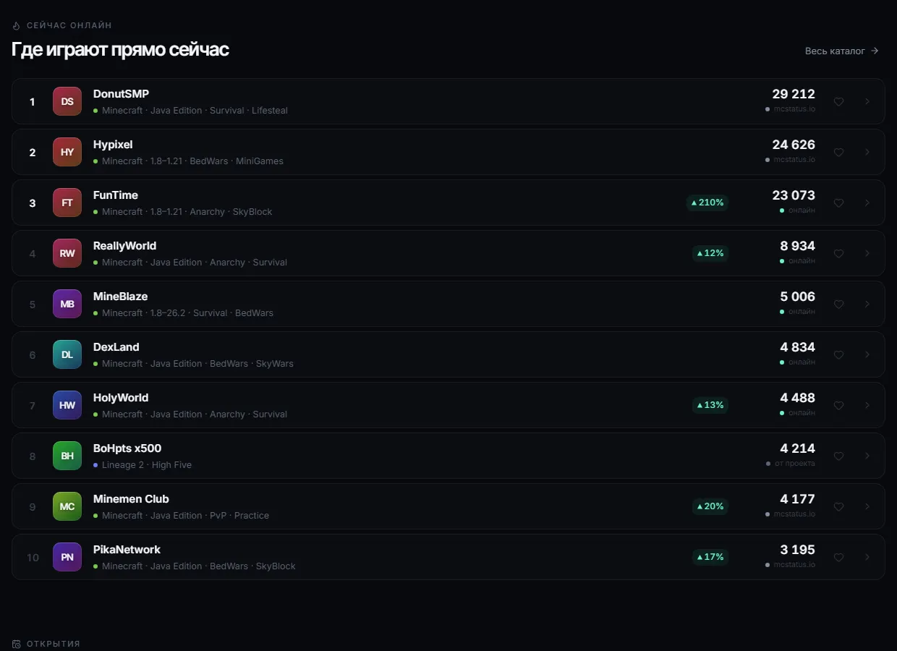 |
| Главная 1440 / 360 | 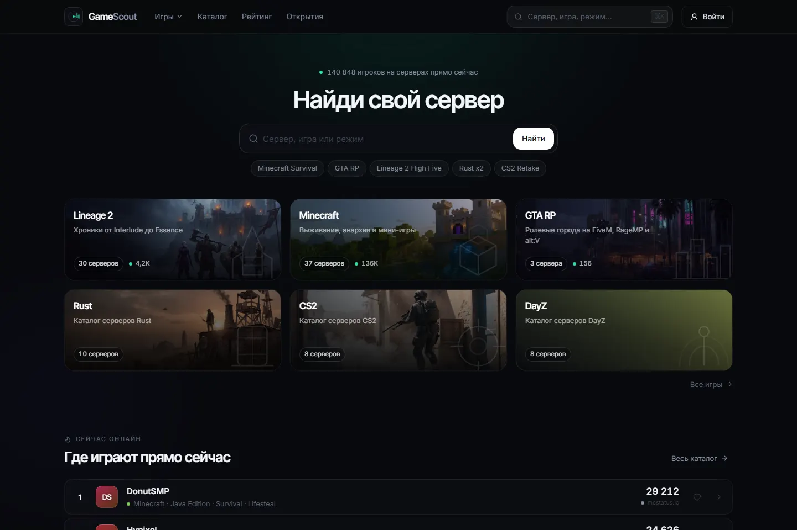  |
| Lineage 2 1920 / 390 | 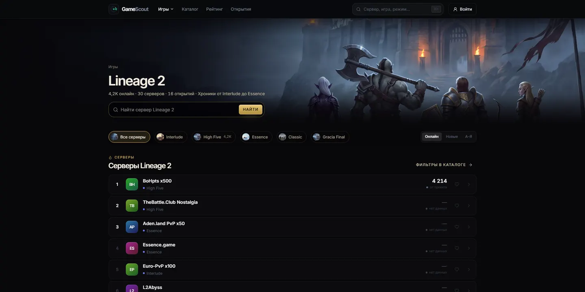  |
| High Five 1440 / 360 | 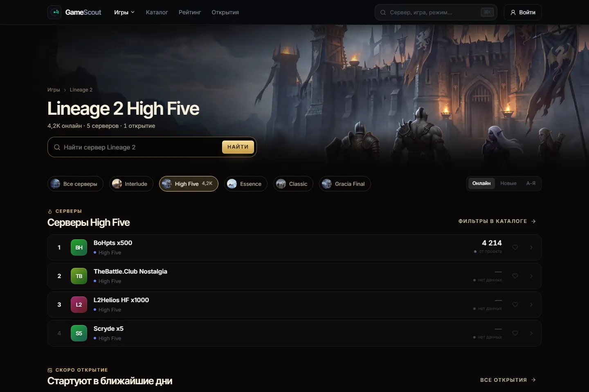  |
| Minecraft 1920 / 390 | 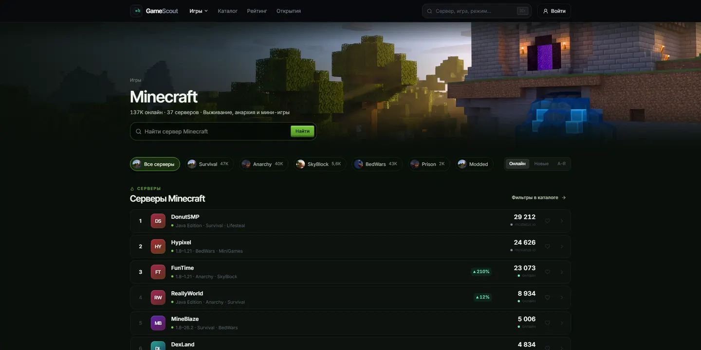 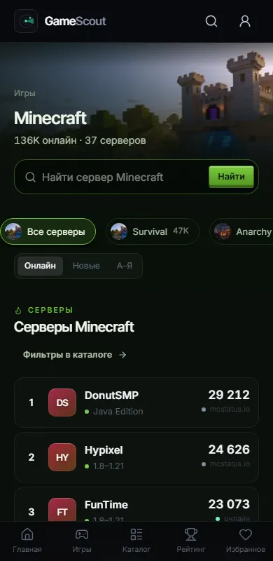 |
| GTA RP 1440 / 360 | 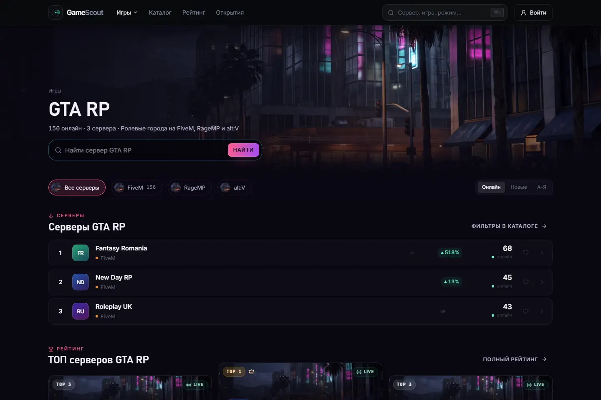  |
| Каталог 1920 / 390 | 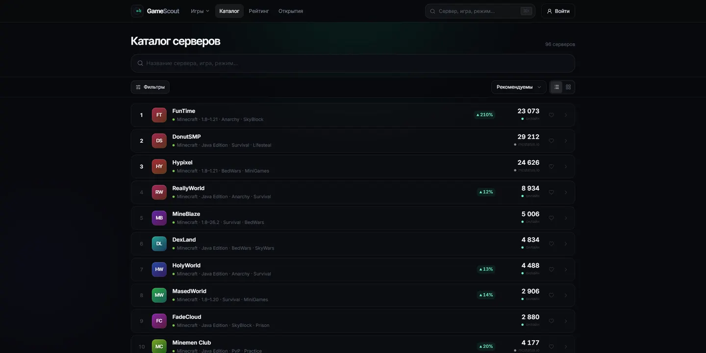 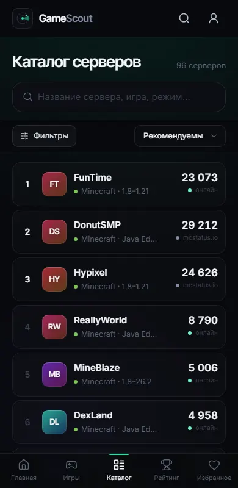 |
| Рейтинг 1440 / 360 | 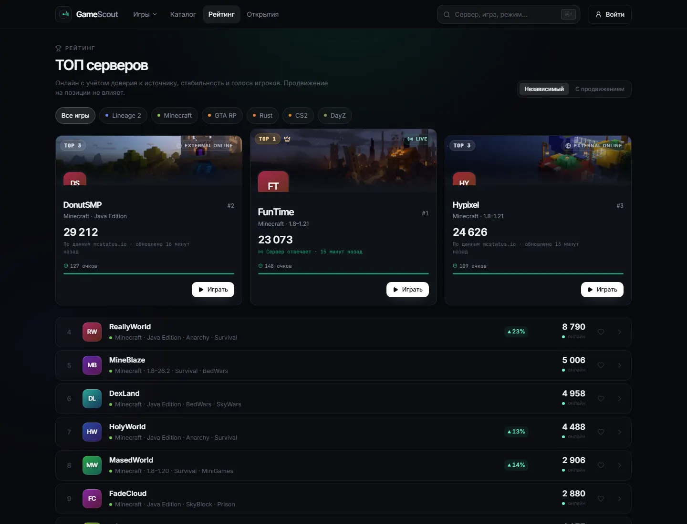  |
| Открытия 1440 / 360 | 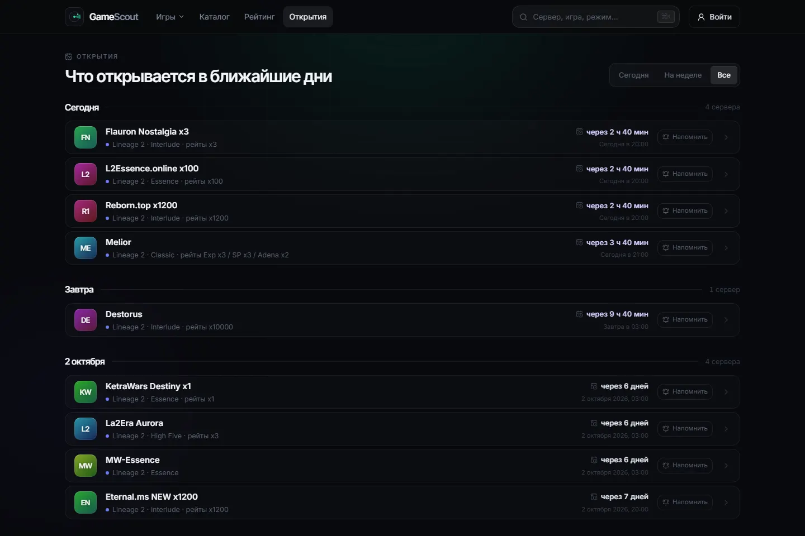  |
| LIVE / EXTERNAL / OWNER_REPORTED | 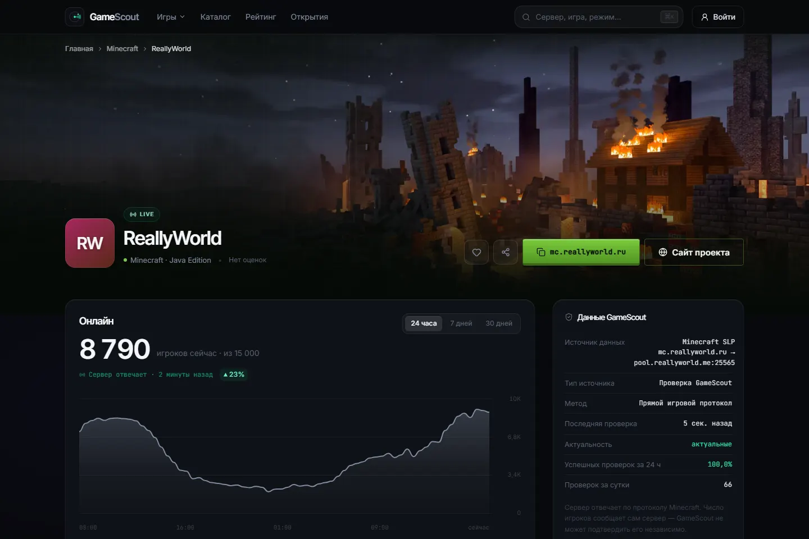 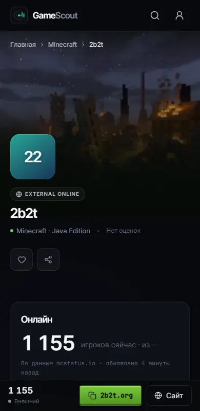 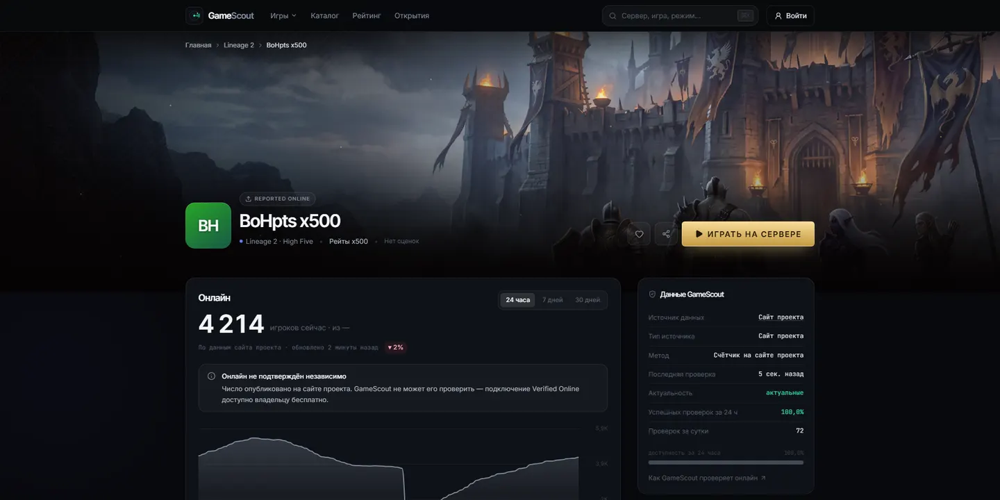 |
| UNKNOWN / PENDING | 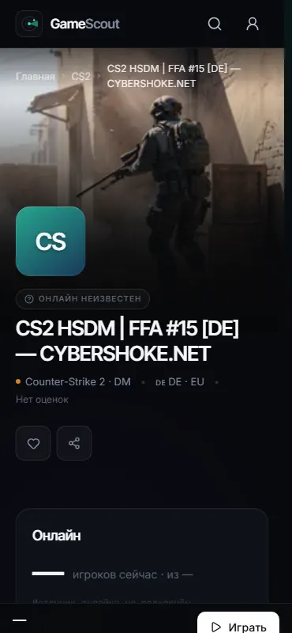 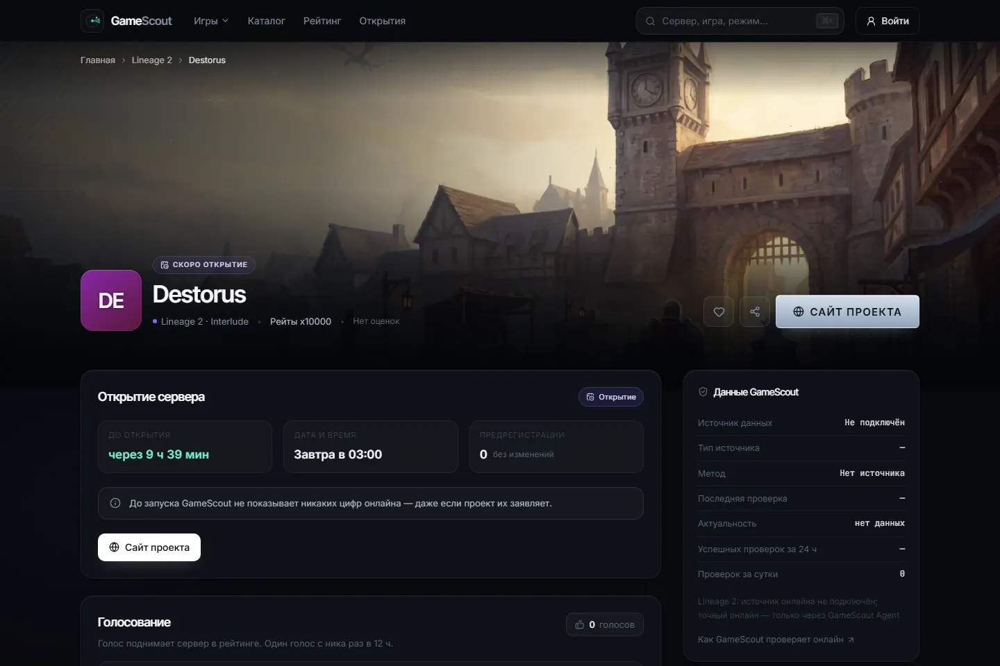 |
| «Скопировать адрес» | 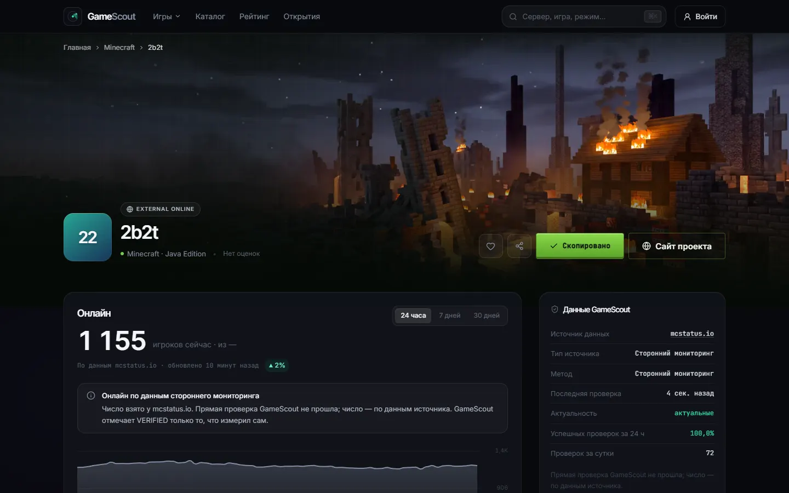 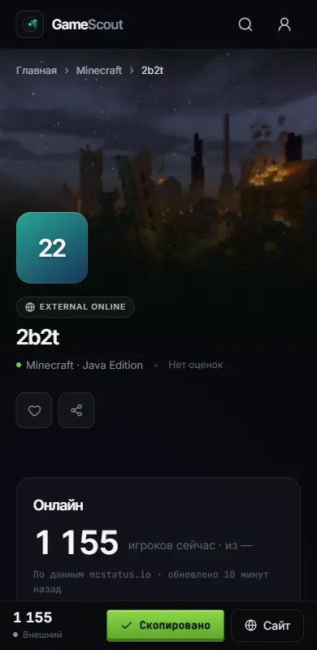 |
