# Staging QA на production-данных (25.09.2026)

Кандидат: `ca979fe` → после правок этого прохода финальный коммит ветки `claude/ru-access` указан в
`git log -1 -- docs/review/2026-09-redesign/staging-qa/README.md`. Apex, `main` и DNS не тронуты.

## Деплой на new.gamescout.online — не завершён

`new.gamescout.online` и apex обслуживает один и тот же шлюз, бакет, функция и origin-Worker, поэтому
«только new.» требует отдельной цепочки. Создано (всё free tier):

| Ресурс | Состояние |
| --- | --- |
| Worker `gamescout-origin-staging` | задеплоен: код кандидата, production D1, `PROXY_ONLY`, секрет; напрямую → 403 |
| Функция `gamescout-api-proxy-staging` | создана, версии нет |
| Шлюз `gamescout-staging` | создан, домен не привязан |
| `new.gamescout.online` | без изменений: всё ещё старая сборка на шлюзе apex |

Публикация версии staging-функции была заблокирована как production-деплой. Обходить блокировку я не стал.
Оставшиеся четыре шага и уборка описаны в `docs/yandex-migration.md`, раздел «Staging на new.gamescout.online».

## Как проверялось вместо этого

- **UI:** точная сборка кандидата (`vite build` + `ru-proxy/build.mjs --noindex`) локально, `/api` — реальный
  production API только на чтение (GET). Все POST (просмотры, клики) перехватывались локально и в D1 не попали.
- **API-совместимость:** одинаковые запросы к production API и к Worker кандидата на той же D1.
- **Ширины:** 1920 / 1440 / 390 / 360, 14 страниц: главная, Lineage 2, High Five, Minecraft, GTA RP, DayZ,
  каталог, рейтинг, открытия, профили LIVE / EXTERNAL / OWNER_REPORTED / UNKNOWN (длинное имя) / PENDING.
- **Внешняя проверка скорости** production API через check-host: 0,2–0,9 с из РФ и Европы.

Данные production на момент проверки:

| Статус | Серверов |
| --- | --- |
| LIVE (своя проверка GameScout) | 26 |
| EXTERNAL (mcstatus.io, mcsrvstat.us) | 14 |
| OWNER_REPORTED (сайт проекта) | 2 |
| UNKNOWN | 38 |
| PENDING (открытия) | 16 |
| VERIFIED | 0 |
| stale | 0 |

## Прошло

- **API после изменения serverDto.** 96/96 серверов, тот же порядок, ноль расхождений в любых полях, кроме
  нового `address` (37 Minecraft-серверов с game-protocol целью, без портов, все адреса и так есть в публичном
  описании). `games`, `rating`, карточка сервера — та же форма. Старый фронт новое поле игнорирует.
- **«Скопировать адрес»** (через Worker кандидата, реальные данные): 1440 и 390 — в буфере `2b2t.org`,
  кнопка показывает «Скопировано» и возвращается, клик пишется как `PLAY_CLICK / copy-address`. У сервера без
  game-protocol цели (BoHpts) кнопки нет, остаётся «Играть на сервере».
- **Реальный онлайн и тренды:** числа совпадают с API, тренд-чипы только при |Δ| ≥ 10 % (12 из 24 в каталоге).
- **«Где играют прямо сейчас»:** 10 строк свежего онлайна, сортировка по числу.
- **Профили всех статусов:** плашка статуса, источник и давность в блоке «Онлайн» и «Данные GameScout»,
  пояснение для EXTERNAL и OWNER_REPORTED, для PENDING — обратный отсчёт и «никаких цифр до запуска».
- **Длинные имена:** «DayzUnderground.com - Chernarus - …», «CS2 HSDM | FFA #15 [DE] — CYBERSHOKE.NET» —
  в профиле переносятся, в строках обрезаются многоточием, ничего не вылезает.
- **Изображения:** 0 битых, 0 ошибок загрузки. На странице 64–199 КБ арта; телефон берёт 800 px, широкий hero — 2560 px.
- **Консоль:** ни одной ошибки JavaScript. Все сетевые ошибки в логах — таймауты моего локального канала
  (с внешних узлов API отвечает быстро) и оборванные при закрытии вкладки события просмотра.
- **Тесты:** typecheck, bundle, adapters 35/35, api, owner, monitoring — проходят.

## Не прошло (и исправлено, коммиты `486383f`, `3780d74`)

1. **Источник числа не виден в строках.** Под числом всегда было «онлайн» — и у своей проверки, и у mcstatus.io,
   и у сайта проекта. На телефоне тултипа нет. Теперь: «онлайн» только у своей проверки, у внешнего монитора —
   его имя, у данных проекта — «от проекта».
2. **Тренд-чипы на телефоне** сжимали имена до «ReallyW…». Чип должен был скрываться, но его `inline-flex`
   перебивал `hidden`. Теперь на телефоне чипов нет, на десктопе остаются.
3. **Страница игры при медленной сети** писала «0 серверов» и показывала пустоту, а при ошибке запроса —
   «В этой хронике пока нет серверов». Теперь: скелетоны строк, счётчик только после загрузки, при ошибке —
   «Не удалось загрузить серверы» и «Повторить».
4. **«онлайн проверяем сами»** стояло рядом с суммой онлайна, которая в основном состоит из чисел мониторингов
   и сайтов проектов (VERIFIED в production — 0). Убрано; строка снова «N игроков на серверах прямо сейчас».
5. **Плитки игр на 360–390 px:** «30 серверов» ломалось на две строки, когда рядом появился онлайн. Теперь чип
   не переносится, онлайн уходит строкой ниже.
6. **«1 157 игроков сейчас · из 1»** у 2b2t (сервер сообщает max = 1). Лимит меньше текущего числа показывается как «—».
   Эта ошибка была и в текущей production-сборке.

## Риски, оставшиеся до apex

- **Кандидат не запускался на настоящем шлюзе.** Не проверены: отдача из бакета с префиксом, relay-функция
  и её холодный старт, заголовки кэша, мобильные сети РФ. Это и есть смысл staging, и он не выполнен.
- **Сборка изменилась после `ca979fe`** (правки выше). Проверена локально на реальных данных, но деплоить
  нужно уже финальный коммит, не `ca979fe`.
- **Кнопка адреса на apex** появится, только если `gamescout-origin` получит код Worker кандидата. Без этого
  фронт работает, просто кнопку не показывает (поле опционально).
- **Загрузка приложения держится на одном запросе** `/api/v1/games`. Если он не прошёл, весь сайт показывает
  «Не удалось выполнить запрос / Повторить» без шапки. Так же ведёт себя текущий apex; в этом проходе не менял.
- **VERIFIED в production — ноль.** Всё, что обещает «проверяем сами», держится на LIVE (26 серверов).

## Скриншоты

| Состояние | Файл |
| --- | --- |
| «Где играют прямо сейчас», источники под числами | 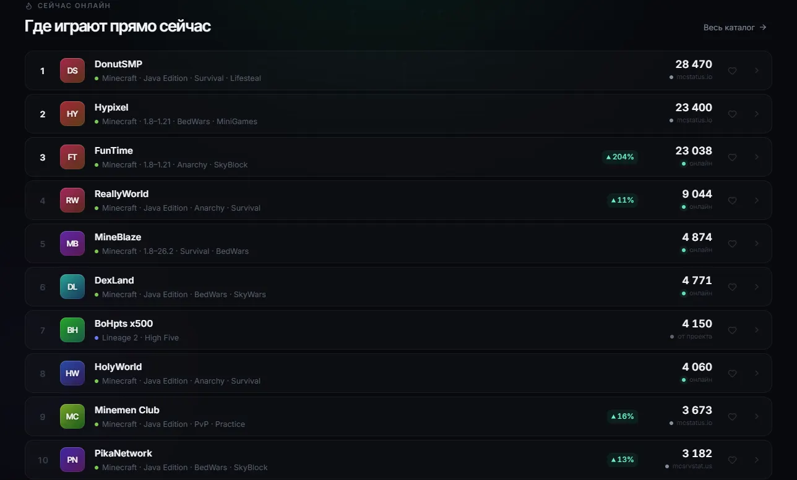 |
| Каталог по онлайну, телефон | 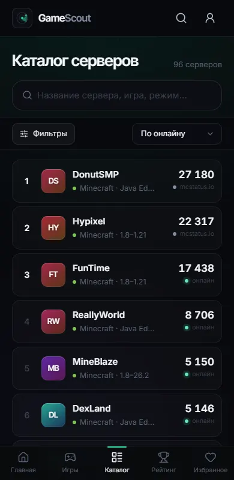 |
| Каталог по онлайну, десктоп, тренд-чипы | 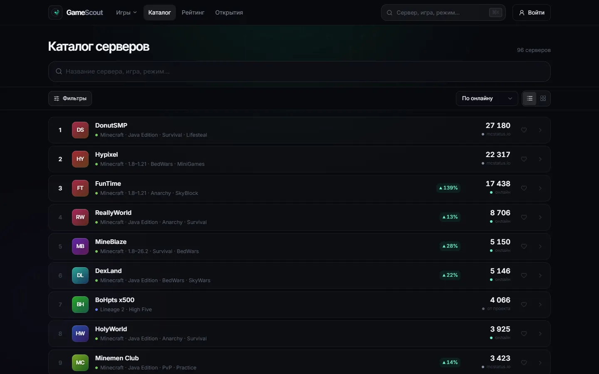 |
| Главная 1440 / 360 |  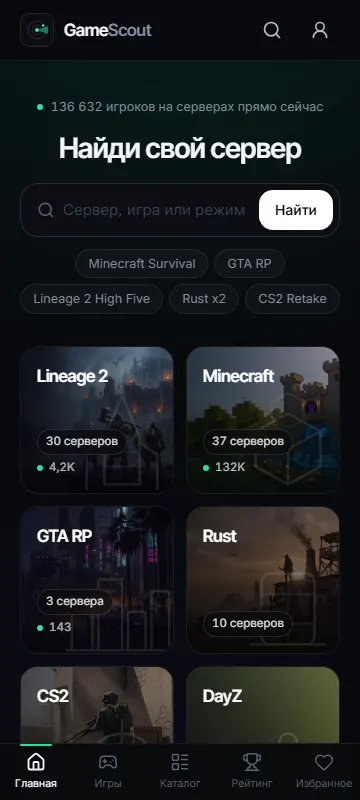 |
| Lineage 2 1440, High Five 390 | 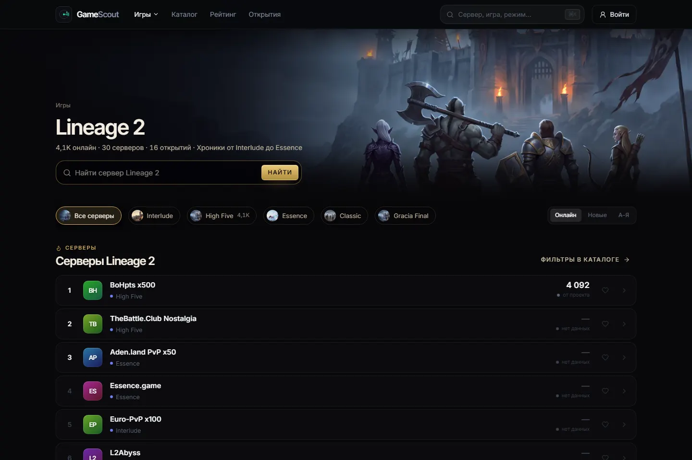  |
| Minecraft 1440, GTA RP 1920 | 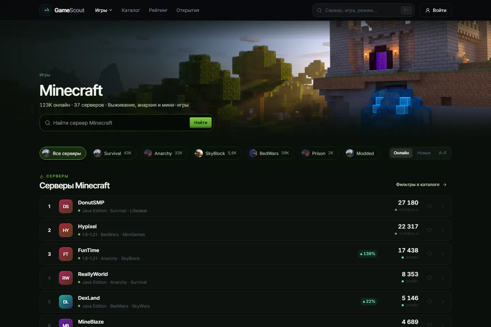 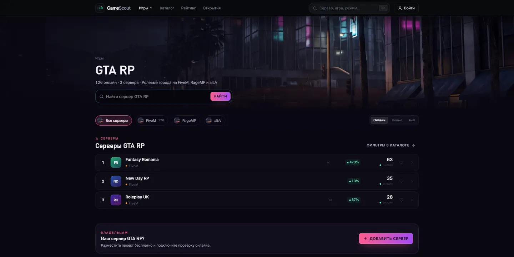 |
| OWNER_REPORTED (BoHpts) | 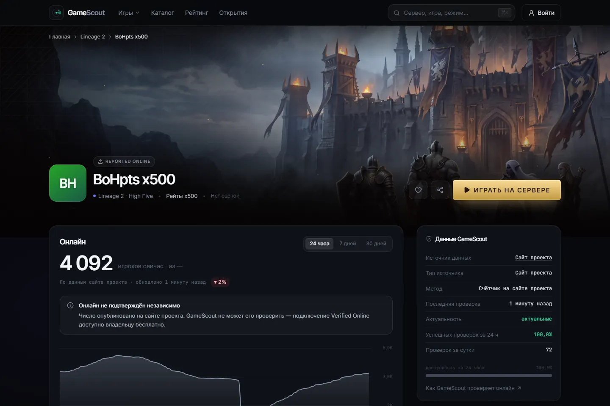 |
| EXTERNAL (DonutSMP) | 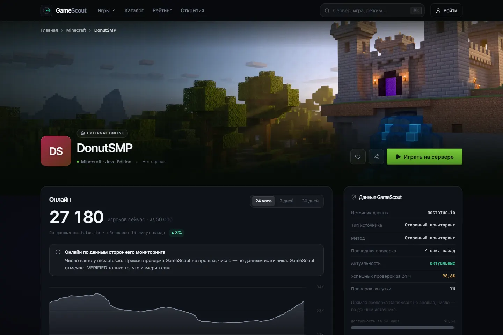 |
| LIVE (ReallyWorld), телефон | 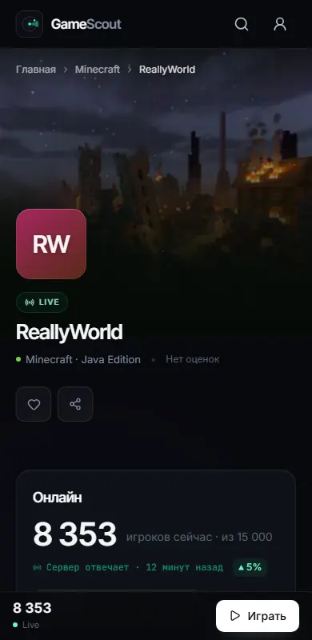 |
| UNKNOWN, длинное имя, 360 | 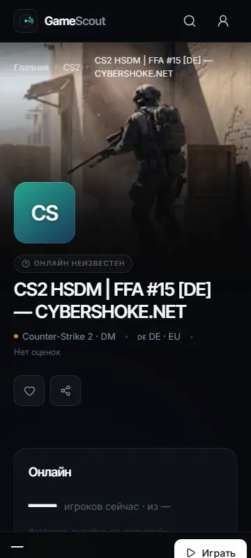 |
| PENDING (Destorus) | 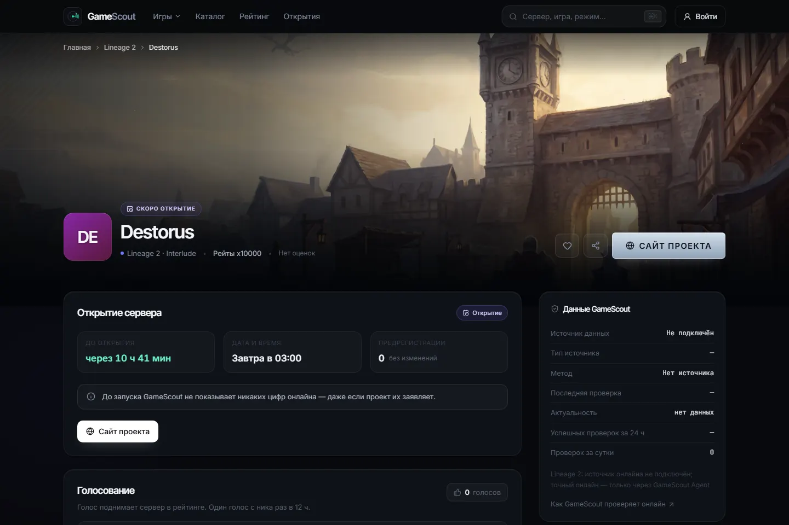 |
| DayZ, длинные имена, 360 | 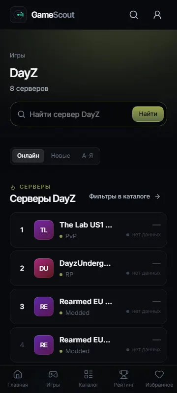 |
| «Скопировать адрес» 1440 / 390 | 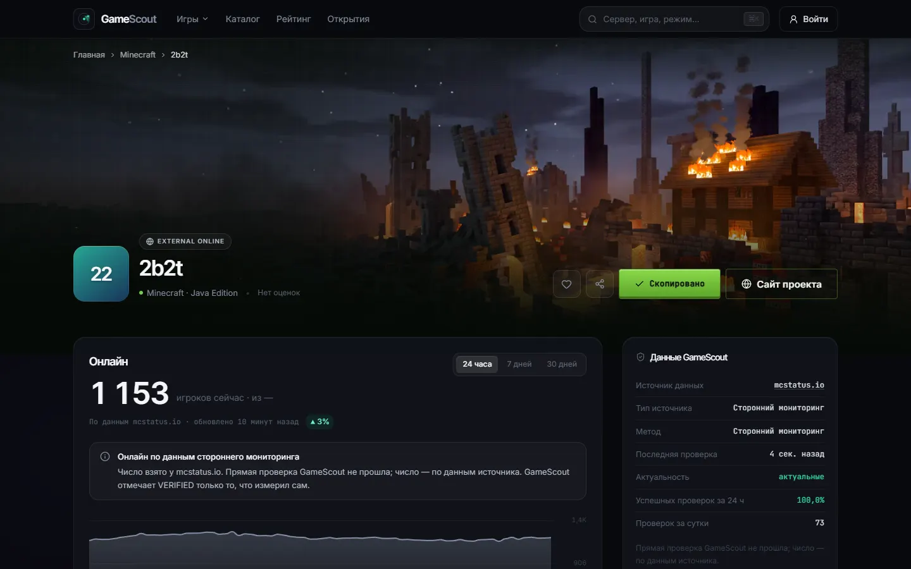 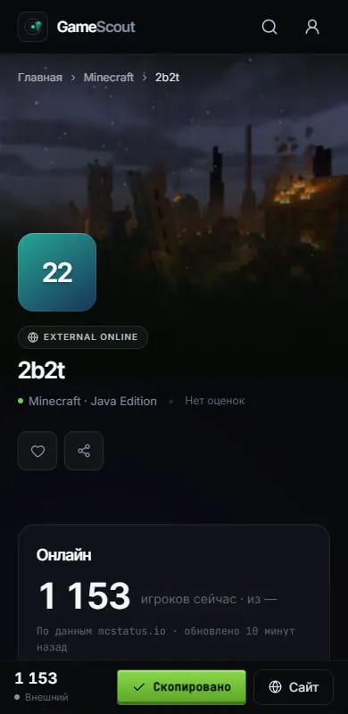 |
| Список грузится / запрос упал | 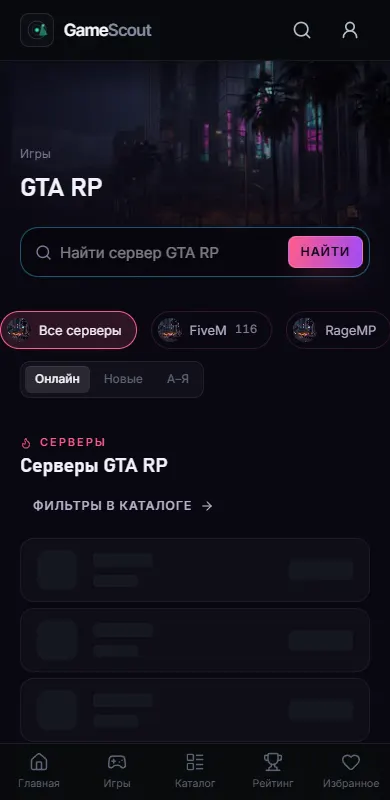 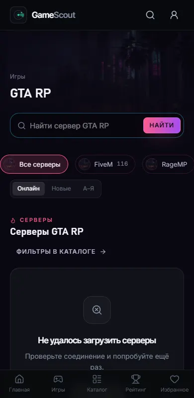 |
